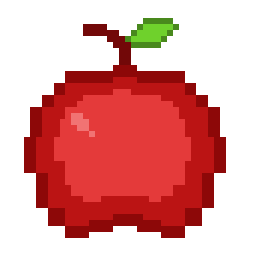
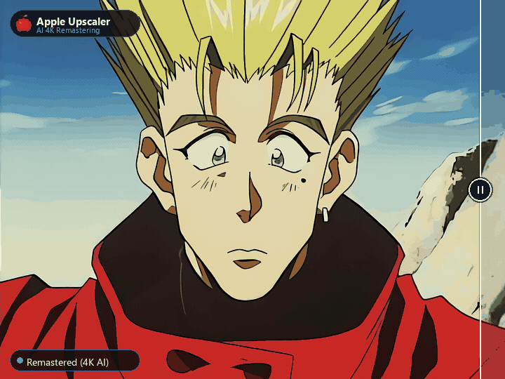

<div align="center">
  
  <h1>🍏 Apple Upscaler Pro</h1>
  <p><strong>Universal AI Anime & Vintage Film Neural Remastering Suite</strong></p>

  [](https://github.com/Dhruvgupta16/apple-upscaler)
  [](https://github.com/Dhruvgupta16/apple-upscaler)
  [](https://github.com/Dhruvgupta16/apple-upscaler)
  [](https://github.com/Dhruvgupta16/apple-upscaler)
  [](https://github.com/Dhruvgupta16/apple-upscaler)
  [](LICENSE)

  <br><br>
  
</div>

---

## 🌟 Overview

**Apple Upscaler Pro** is a modern, standalone desktop remastering suite engineered specifically for anime, classic animation, telecine films, and photos. It bridges the gap between raw AI power and intuitive usability:

- **For Beginners:** Instant 1-click remaster presets, plain-English adjustments, and a zero-friction interface.
- **For Colorists & Enthusiasts:** Full DaVinci Resolve-grade 3-way Lift/Gamma/Gain color wheels, AI color matching, Reinhard luminance transfer, 3D LUT tetrahedral interpolation, and authentic CRT/VHS analog physics.

---

## ✨ Key Features

### 🍏 1. Dual Workflow Engine: Beginner Simple Mode vs Pro Studio
- **Simple Mode (1-Click Simplicity):**
  - Instant curated style cards:
    - 🌟 **AI 4K Remaster**: Real-ESRGAN neural line reconstruction, CAS edge enhancement, and dynamic contrast.
    - 🎨 **Vibrant Cel**: Deep telecine blacks and punchy 90s animation saturation.
    - 📺 **90s CRT TV**: Sony Trinitron aperture grille, phosphor sub-pixels, and curved tube glow.
    - 📼 **Vintage VHS**: Realistic head tracking distortion, RGB chromatic aberration, and dialogue EQ.
    - 🎬 **35mm Film**: Theatrical film stock warmth, fine grain, and soft highlight knee.
    - 🧼 **Studio Clean**: Clean analog noise, color banding, and compression artifacts.
    - ⚖️ **Flat Source**: Untouched baseline comparison.
  - 4 plain-English sliders: *Detail Crispness*, *Color Vibrancy*, *Shadow Brightness*, and *Retro Effect Intensity*.
- **Pro Studio Mode (Colorist Grade):**
  - Full granular control over every aspect of color science, noise floors, scaling algorithms, audio filters, and encoding parameters.

### 🧠 2. AI Neural Detail Reconstruction
- **Real-ESRGAN Vulkan GPU Acceleration:**
  - `Real-ESRGAN Anime V3`: Specialized line-art detail reconstruction.
  - `Real-ESRGAN 6B Anime Cel`: Maximum redraw model for vintage 480p/576p telecine cels.
  - `Lanczos-3 Sinc & Spline36`: 150+ FPS mathematical scalers with AMD CAS line sharpening.
- **A/B Model Comparison:** Side-by-side split curtain comparison between neural detail synthesis and traditional interpolation.

### 🎨 3. DaVinci Resolve-Grade 3-Way Color Wheels
- **Lift / Gamma / Gain Wheels:** Independent chromatic grading across Shadows (Lift), Midtones (Gamma), and Highlights (Gain).
- **Master Luminance Sliders:** Adjust black pedestal and highlight gain without altering chromatic vector balance.
- **60 FPS Live GPU Viewport:** Real-time shading in hardware while dragging wheels or sliders with zero latency.
- **Reinhard AI Color Matching:** Recreate the exact color palette of any reference image or cinematic screenshot automatically.
- **3D LUT (.CUBE) Profile Engine:** Tetrahedral interpolation for professional 3D LUT profiles with blend intensity control.

### 📺 4. Authentic Retro CRT & VHS Analog Emulation
- **Aperture Grille & Phosphor Mask:** Red/Green/Blue sub-pixel triads with dynamic scanline luminance.
- **Curved Glass Tube Faceplate:** Realistic 3D perspective barrel curvature and tube blooming.
- **VHS Tape Tracking Glitch:** Dynamic head tracking noise bar and VHS transport jitter.
- **True RGB Chromatic Split:** Dynamic color fringe split simulating vintage magnetic tape playback.

### ⚡ 5. Performance & Workflow
- **Universal Multi-Format Support:** Videos (`.mkv`, `.mp4`, `.avi`, `.mov`, `.ts`, `.webm`, `.flv`) and photos (`.png`, `.jpg`, `.jpeg`, `.webp`, `.bmp`, `.tiff`).
- **Season Batch Queue:** Add full anime seasons or photo sets; queue them for one-click unattended processing.
- **Folder Navigation:** Seamlessly jump through episodes or photos with topbar arrows or keyboard shortcuts (`[` and `]`).
- **Full Undo / Redo History Stack:** 50-step memory supporting `Ctrl+Z` and `Ctrl+Y` / `Ctrl+Shift+Z`.
- **Audio & Subtitle Preservation:** Keeps multi-track audio (English, Japanese, 5.1 Surround) and soft subtitles (ASS/SRT/PGS) intact.
- **Replace/Delete Original Option:** Automatic cleanup of old un-remastered source files upon successful export.
- **PotPlayer Live Inspection:** Launch and inspect color-graded preview clips directly in PotPlayer.

---

## ⌨️ Keyboard Shortcuts

| Shortcut | Action |
| :--- | :--- |
| <kbd>Ctrl</kbd> + <kbd>Z</kbd> | Undo last adjustment |
| <kbd>Ctrl</kbd> + <kbd>Y</kbd> / <kbd>Ctrl</kbd> + <kbd>Shift</kbd> + <kbd>Z</kbd> | Redo adjustment |
| <kbd>[</kbd> | Previous episode / photo in active folder |
| <kbd>]</kbd> | Next episode / photo in active folder |
| <kbd>Space</kbd> | Quick 15s sample render & preview |
| <kbd>F</kbd> | Toggle Fullscreen |

---

## 🚀 Quick Start

### Running from Executable
Download the latest `Apple_Upscaler.exe` from Releases, double-click to launch, and drag & drop any video or photo!

### Running from Source
```bash
git clone https://github.com/Dhruvgupta16/apple-upscaler.git
cd apple-upscaler
pip install -r requirements.txt
python apple_upscaler.py
```

---

## 📄 License
Released under the [MIT License](LICENSE).
